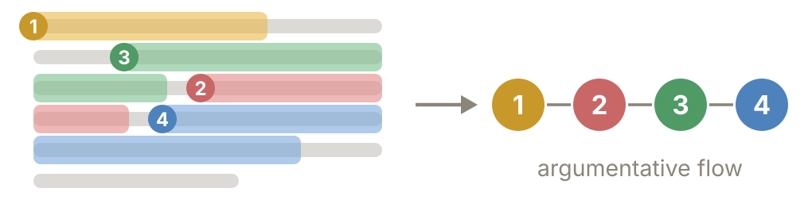

Yours to write. Some questions to start from:

- How do you find the part of a paper most worth fixing?
- Which rules turned out to be general?

## Rewrite the abstract (or title) 
Treat this as an exercise in understanding and communicating the paper's core contribution. Before rewriting, identify the central problem, the key insight or novelty, the proposed approach, and the main results. Make every sentence earn its place: prioritize clarity, precision, and information over impressive-sounding language. For a title, aim to capture the paper's main idea in as few words as possible. For an abstract, make sure a reader can understand what the paper does, why it matters, and what it achieves without reading the rest of the paper.

## What's worth editing
When reading the paper for the first time, notice what part takes you long to read or what part you find yourself having to go back to again and again, rereading and understanding things that weren't clear on the first read based on the next context. These areas probably can be written better in a way that the first read clears up most of the confusion.

## Writing principles

### Flow

- 
  **Flow of words.** Start each sentence with something the reader already knows, and end it with what is new. Let the end of one sentence set up the start of the next.

  To check, read only the opening words of each sentence. Each opening should pick up something the reader has already seen. Where a sentence opens with a new term, the flow breaks.

- 
  **Flow of ideas (argumentative flow).** This is the logic underneath the writing. Before you write any sentences, list your ideas, number them, and settle only their order: each idea should lead to the next. Then turn each idea into sentences.

## Additional resources

- [Writing tips](https://docs.google.com/document/d/14Wax8M5w8F_8miDlYJ9-I6wqpelxlXjCEUbkNzNMqqE/edit?usp=sharing): an ever-growing guide (see *Title*, *Abstract*, *Review*, *Sentence*)
- [paper-sharpener](https://github.com/borgr/paper-sharpener): Claude Code writing assistant built on that guide

<!-- Add sections with ## and ### headings; the contents sidebar builds itself from them.
     Mid-semester we reread this guide as a newcomer would and cut it back to what helps. -->
