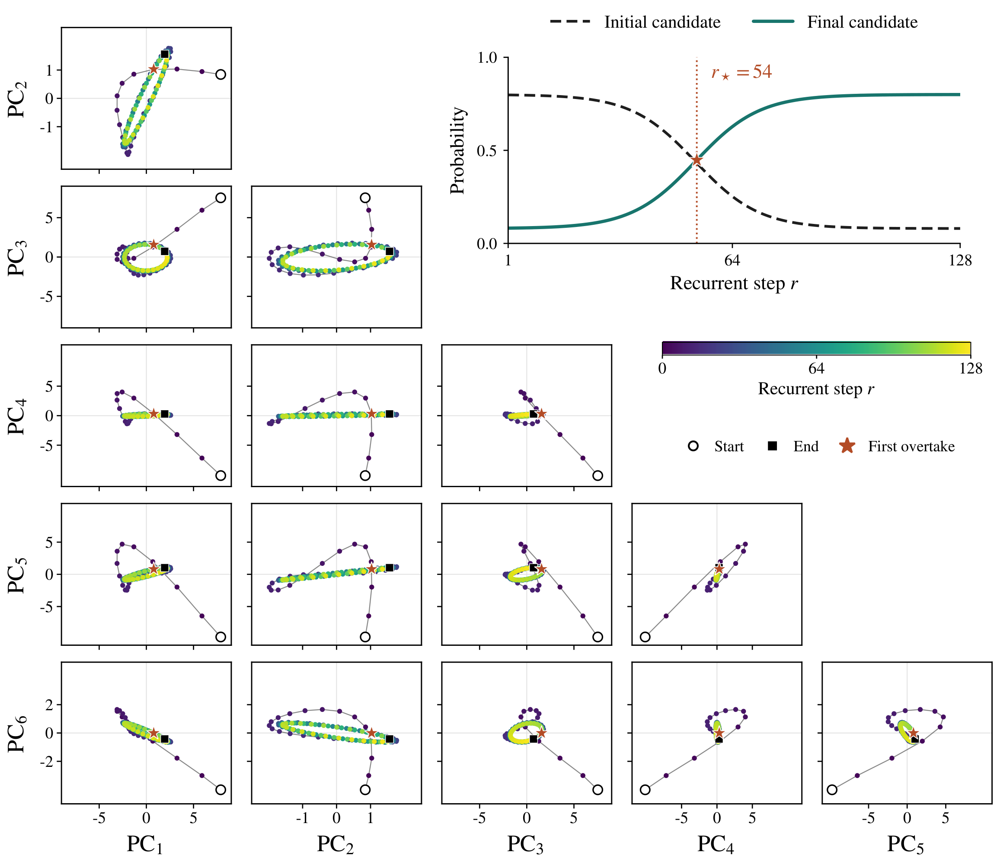

**The original**

Figure 12 shows what the model does internally as it uses more computation. The figure shows selected tokens moving through latent space over recurrent steps. Some trajectories appear to converge, whereas others orbit or drift. How do these movements relate to changes in the model’s predictions?

The original shows three pairs of principal components: PC1–PC2, PC3–PC4, and PC5–PC6. These are only three of the fifteen possible pairs among the first six components. A loop can look narrow or nearly line-like in one projection and open up in another, so how we choose the planes affects how we perceive the geometry.

The input passages are also difficult to find, e.g., the arithmetic question appears in the caption of Figure 16, but not in Figure 12. Finally, the trajectories alone do not seem to be showing if the model’s prediction changes during the recurrence process.

**The redesign**

Note that this is a design demonstration using synthetic trajectories and probabilities, since I did not find the activations in their repository. The additional projections and probability crossings shown here are therefore visual examples, not recovered measurements or new findings about the model.

I replace each set of three projections with a corner plot showing all fifteen pairs. A probability inset and a star marker show when we move from the initial to the final prediction of the model.

**Figure 12**. Orbital and convergent trajectories across recurrent steps. Each recurrent step reapplies the same transformer block to update hidden states while the input sequence remains fixed. Here, $r$ counts internal iterations. The corner plot shows the orbital dynamics from token “3” in “Claire makes a 3 egg omelet every morning for breakfast. How many dozens of eggs will she eat in 4 weeks?”. We show all 15 pairwise views of the six principal-component (PC) coordinates. Color denotes $r=0$–128. Open circles and filled squares mark initial and final states. Insets track synthetic probabilities of two fixed candidate tokens at a fixed readout positions. Stars mark their first overtake in both the inset and trajectory ($r_\star=54$ in A and $18$ in B).

**What changed and why**

- Showing the fifteen component pairs makes the dependence on projection easier to inspect.
- A recurrence colorbar and endpoint markers make the progression of the trajectory more clear.
- A probability inset with a star marker connects the change in response event to its location along the trajectory.
- The caption shows the exact sentence used in the experiment and briefly explains what we are tracking, without having to read all the paper to understand it.
