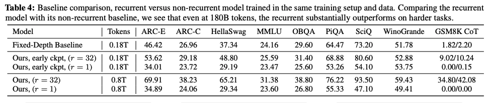
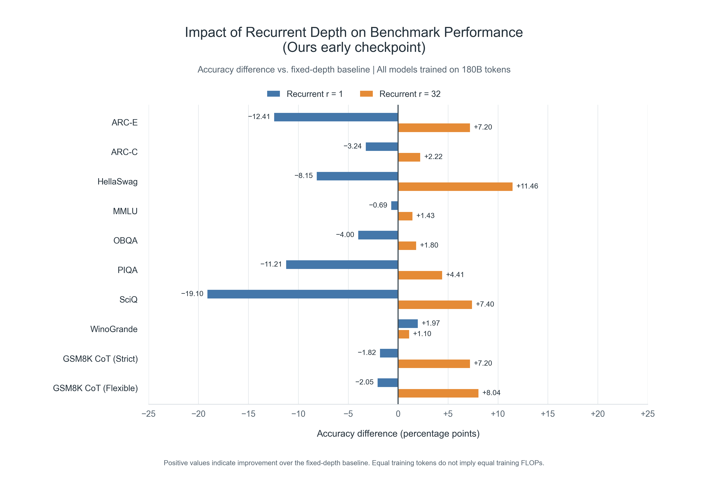

## The original

Table 4 in *Scaling up Test-Time Compute with Latent Reasoning: A Recurrent Depth Approach* (Geiping et al., 2025) compares recurrent models with a fixed-depth Transformer baseline across several benchmarks.

The table is useful for looking up exact scores, but it makes the reader work to see the improvement over the baseline. For each benchmark, we must find the relevant rows, subtract their scores, and remember the difference while moving to the next column.

## The redesign

The redesigned chart focuses on **“Ours early ckpt” at r=1 and r=32**, compared with the fixed-depth baseline. All three rows use **180B training tokens**; the later 800B-token checkpoints are excluded.

Each bar shows **recurrent accuracy minus baseline accuracy, in percentage points**, rather than a relative percentage improvement. For example, HellaSwag changes from 37.34% for the baseline to 29.19% at r=1 and 48.80% at r=32: the bars therefore show **−8.15** and **+11.46** percentage points.

The chart preserves the table's benchmark order and includes all ten metrics. The two GSM8K columns are labeled separately as **GSM8K CoT (Strict)** and **GSM8K CoT (Flexible)**.

## What changed and why

- **A shared zero line makes the comparison immediate.** Bars extending right indicate improvement over the baseline; bars extending left indicate lower accuracy.
- **Paired blue and orange bars reveal the effect of depth.** Each benchmark places r=1 beside r=32, so the reader can compare their direction and magnitude without scanning between table rows.
- **Matching training-token counts keeps the scope clear.** Equal training tokens do not imply equal training FLOPs, so this is a comparison at a matched token budget.

The result is easier to process because the reader can see the differences instead of calculating them mentally. The overall pattern is visible at a glance: r=32 beats the fixed-depth baseline on every displayed metric, whereas r=1 falls below it on nine of ten. The exception is also visible: **WinoGrande improves by +1.97 points at r=1 and +1.10 at r=32**, so increasing depth does not improve every benchmark. The chart reduces the arithmetic and memory needed to understand both the main pattern and its exception.
