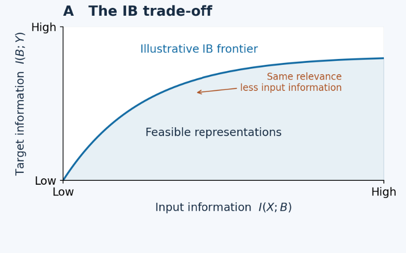
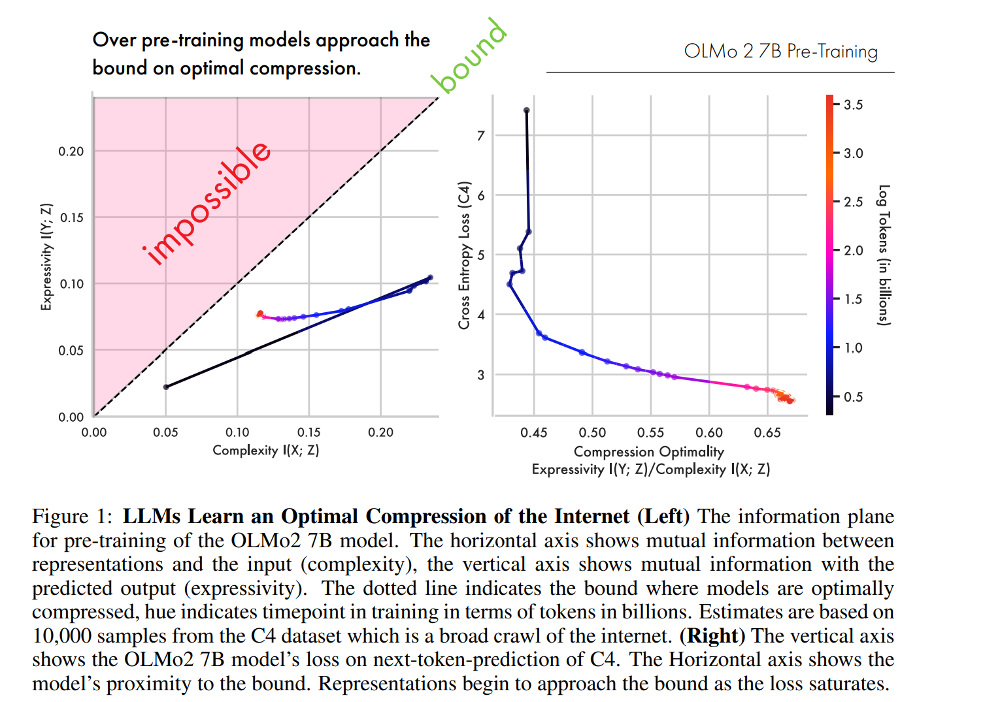

---

title: "Learning about Information Bottleneck"
description: How can we measure the usefulness of latent representations?
paper: recurrent-depth-latent-reasoning 
role: learning
by: [leonicus]
---
# What makes a latent representation good?

Can we tell whether a model's latent representation is good? The information bottleneck gives us a way to ask a more precise question. How much of the input does the representation need to retain to predict a particular target?

## The information bottleneck

In 1999, Naftali Tishby, Fernando C. Pereira, and William Bialek proposed a way to think about representations using information theory and rate–distortion theory. Their idea was to compress an input while preserving as much information as possible about a target. A representation can discard details that matter for one task and still be excellent for another.

Let $X$ be the input, $Z$ its compressed representation, and $Y$ the target. The information bottleneck objective is $\min_{p(z\mid x)}\bigl[I(X;Z)-\beta I(Z;Y)\bigr]$. Here, $I(X;Z)$ measures how much information $Z$ retains about the input, and $I(Z;Y)$ measures how much knowing $Z$ reduces uncertainty about the target. A larger $\beta$ gives more weight to preserving target information. In language modeling, a natural choice is to take $X$ as the preceding context and $Y$ as the next token.

## Reading the information plane

Plot input information $I(X;Z)$ on the horizontal axis and target information $I(Z;Y)$ on the vertical axis. For a fixed joint distribution of inputs and targets, the information bottleneck frontier gives the most target information any encoding can retain at a given input-information budget. Points above it are unattainable. A point below it leaves room to retain more target information at the same budget.

*An illustrative frontier. The figure uses $B$ for the representation denoted by $Z$ in the text.*

## What happens during LLM training?

Shwartz-Ziv and Tishby reported two phases in early neural-network experiments. During fitting, representations became more informative about the target. During compression, they shed input information while retaining much of their predictive information. Whether this pattern generalizes across architectures and training setups remains an empirical question.

In *Learning is Forgetting*, Henry Conklin and colleagues applied a soft entropy estimator to LLM activations. The estimator softly assigns normalized activation vectors to reference directions, then uses the resulting distribution to estimate entropy. This makes it practical to track how much information the representations carry about selected input and output features across training checkpoints.

In OLMo 2 7B, the authors observed an initial expansion in the estimated input and target information, followed by a phase in which input information fell and the ratio $I(Z;Y)/I(X;Z)$ rose. The dashed diagonal in their plot represents the data-processing upper bound $I(Z;Y)\leq I(X;Z)$ in the idealized setting where $Z$ is encoded from $X$. The true frontier depends on the joint distribution of $X$ and $Y$ and can lie below that diagonal. The trajectory shows how the estimated trade-off changed during training under the paper's measurement setup.

*Figure 1 from [Conklin et al. (2026)](https://arxiv.org/html/2604.07569v1#S1.F1).*

## What changes during reasoning?
The reason I think this relates to looped transformers is that the information bottleneck framework suggests a way to think about the reasoning process. The information plane can help us understand how the model's representation changes as it reasons. Instead of comparing training checkpoints, we could hold the model fixed and compare successive reasoning steps. In text chain-of-thought, the next-token target changes as the model writes, and different stretches of text can serve different subtasks. A looped transformer can update its latent state several times before emitting a token. Which intermediate quantities become accessible during those updates is an empirical question.

## References

- Tishby, Pereira, and Bialek. [The Information Bottleneck Method](https://arxiv.org/abs/physics/0004057). 1999 conference paper, posted to arXiv in 2000.
- Tishby and Zaslavsky. [Deep Learning and the Information Bottleneck Principle](https://arxiv.org/abs/1503.02406). 2015.
- Shwartz-Ziv and Tishby. [Opening the Black Box of Deep Neural Networks via Information](https://arxiv.org/abs/1703.00810). 2017.
- Conklin et al. [Learning is Forgetting: LLM Training As Lossy Compression](https://arxiv.org/abs/2604.07569). 2026.
