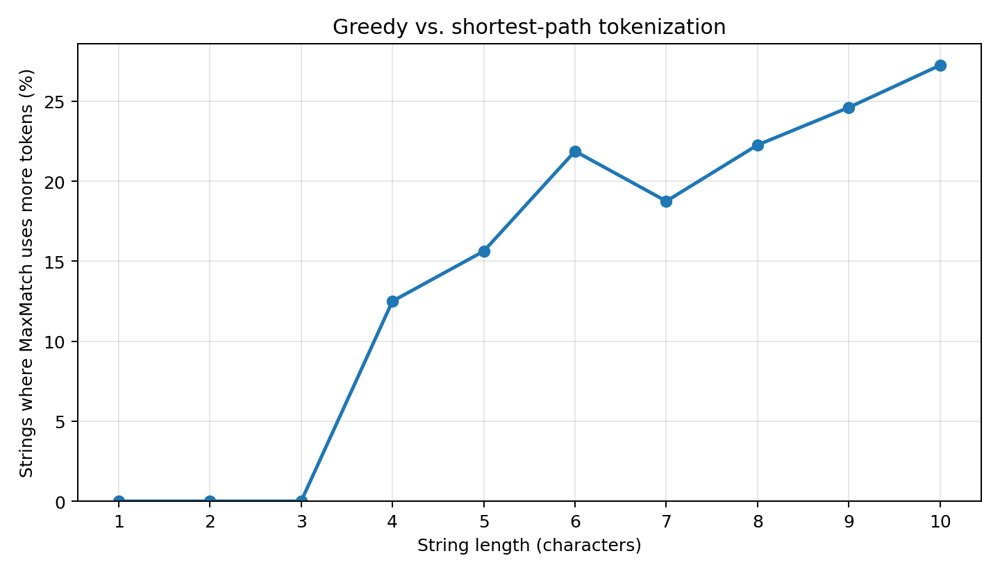

## What I reimplemented
I focused on **Section 3.6** of *Tokenization: A Survey for Modern NLP*, specifically **Figure 3.2 and Example 3.3** (p. 25). The survey contrasts **MaxMatch**, which greedily takes the longest vocabulary prefix from left to right, with **PathPiece**, which finds a segmentation that uses the fewest tokens (a shortest path through a segmentation lattice).

I implemented both inference algorithms from scratch in Python, without training a tokenizer or running a language model. First, I reproduced the survey's concrete example using its exact input and vocabulary. Then I extended the comparison to a small, exhaustive synthetic benchmark to measure **how often MaxMatch uses more tokens than PathPiece**.

The extension is **my own experiment**, not a reported result from the survey.

## The code

The central difference is the local greedy choice versus the globally optimal dynamic-programming recurrence:

```python
def maxmatch(text, vocabulary):
    vocab = set(vocabulary)
    output = []
    i = 0
    while i < len(text):
        # Take the longest valid token starting at position i.
        matches = [t for t in vocab if text.startswith(t, i)]
        if not matches:
            raise ValueError("No valid segmentation")
        token = max(matches, key=len)
        output.append(token)
        i += len(token)
    return output


def pathpiece(text, vocabulary):
    vocab = set(vocabulary)
    n = len(text)
    dp = [float("inf")] * (n + 1)
    choice = [None] * (n + 1)
    dp[n] = 0

    # dp[i] = minimum tokens required to segment text[i:].
    for i in range(n - 1, -1, -1):
        for token in sorted(vocab, key=lambda t: (-len(t), t)):
            if text.startswith(token, i):
                candidate = 1 + dp[i + len(token)]
                if candidate < dp[i]:
                    dp[i] = candidate
                    choice[i] = token

    if dp[0] == float("inf"):
        raise ValueError("No valid segmentation")
    output = []
    i = 0
    while i < n:
        output.append(choice[i])
        i += len(choice[i])
    return output
```

The full script includes input validation, automated assertions, exhaustive enumeration, a results CSV, and plotting. It uses only standard Python plus Matplotlib for the figure.

**Full code:** [tokenization_experiment.py](/assets/code/tokenization_survey/tokenization_experiment.py)

## Results

### 1. Reproducing the survey's example

Using the paper's input `abcdefg` and vocabulary `{a, b, c, d, e, f, g, abc, abcd, bcdef, defg}`, the implementation produced:

| Method | Segmentation | Token count |
| --- | --- | ---: |
| MaxMatch | `abcd | e | f | g` | 4 |
| PathPiece | `abc | defg` | 2 |

**This exactly matches Figure 3.2 and Example 3.3 in the survey.** MaxMatch commits to `abcd`, leaving three single-character tokens; PathPiece instead chooses `abc | defg`, requiring only two tokens.

### 2. New synthetic experiment (not reported in the survey)

To measure how often the greedy method is suboptimal, I fixed the synthetic vocabulary

`{a, b, aa, aaa, aaaa, ab, aba, abab, abb, baab, bab, baba, bbab, bbbb}`

and enumerated **all 2,046 binary strings of lengths 1 through 10**. Both algorithms use exactly the same fixed vocabulary, which includes the single characters to ensure every input can be segmented.

The metric is the fraction of strings for which

`len(MaxMatch(s)) > len(PathPiece(s))`.

| String length | Strings tested | Greedy suboptimal | Failure rate |
| ---: | ---: | ---: | ---: |
| 4 | 16 | 2 | 12.50% |
| 6 | 64 | 14 | 21.88% |
| 8 | 256 | 57 | 22.27% |
| 10 | 1,024 | 279 | 27.25% |
| **All lengths 1–10** | **2,046** | **507** | **24.78%** |



The plot and numerical results are generated by the script. These measurements **are not numbers from the survey** and should not be interpreted as real-world failure rates for production tokenizers. They depend on the synthetic vocabulary and the input distribution. Because PathPiece explicitly minimizes token count, its count cannot be worse than MaxMatch's for the same vocabulary.

## What I learned

A locally reasonable segmentation choice does not necessarily optimize the complete sequence. In the paper's example, taking the longest prefix forces MaxMatch into a worse segmentation, whereas dynamic programming considers how today's choice affects the remaining suffix.

The exhaustive comparison gave a simple way to quantify this phenomenon, not just demonstrate one counterexample. It also highlighted an important distinction: **minimum token count is a specific objective**, not a guarantee of better downstream language-model quality. Real tokenizers may prioritize other properties, and the survey notes that inference algorithms can have different objectives.
