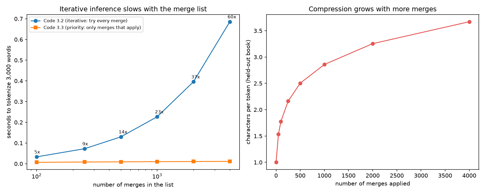

## What I reimplemented

**Section 3.1 (Byte-pair encoding)** of *Tokenization: A Survey for Modern NLP*. The survey prints three short Python listings:

- **Code 3.1:** BPE *training*. Start from characters, and repeatedly merge the most frequent adjacent pair.
- **Code 3.2:** BPE *inference*, iterative version. Try every merge in the list, in order.
- **Code 3.3:** BPE *inference*, priority version. Find the earliest merge that applies, apply it, repeat.

The survey makes several claims about them that I could check:

1. Code 3.3 is "equivalent to" Code 3.2 (caption of Code 3.3).
2. Code 3.2 wastes computation, and the waste grows with the merge list (Section 3.1.2).
3. Merging frequent pairs "tends to surface linguistically meaningful units such as morphemes" (start of Section 3.1).

The other reimplementation of this paper (MaxMatch vs. PathPiece, Section 3.6) is about general inference algorithms. This post is about the BPE trainer and its two decoders. The experiments below are **mine**, not results from the survey.

## The code

I typed the three listings exactly as printed (the PDF lost the indentation of two lines, which I restored) and ran them as they are. As an independent check, I wrote a second implementation that does not copy their loops: it counts each distinct word once (the "pretoken-to-count dictionary" optimization that the survey mentions but does not show) and merges only in words that contain the pair.

```python
# Code 3.1 core: the whole trainer is this loop
while len(vocab) < target_vocabulary_size:
    pair_counts = collections.Counter(
        (a, b) for pretoken in pretokenized_corpus for a, b in zip(pretoken, pretoken[1:]))
    if len(pair_counts) == 0: break
    max_pair = max(pair_counts, key=pair_counts.get)   # ties: first pair seen
    merges.append(max_pair)
    vocab.append(max_pair[0] + max_pair[1])
    for pretoken in pretokenized_corpus:
        apply_merge(pretoken, max_pair)
```

Full code: [survey_bpe.py](/assets/code/tokenization_survey/bpe/survey_bpe.py) (the survey's listings), [fast_bpe.py](/assets/code/tokenization_survey/bpe/fast_bpe.py) (my independent version), [run_experiments.py](/assets/code/tokenization_survey/bpe/run_experiments.py), [make_figure.py](/assets/code/tokenization_survey/bpe/make_figure.py), and the raw numbers in [results.json](/assets/code/tokenization_survey/bpe/results.json). It uses only the Python standard library, plus Matplotlib for the figure.

**Data.** Training: *Pride and Prejudice* (718,465 characters, 148,283 words, 8,517 distinct). Testing, never seen in training: *Frankenstein* (418,285 characters, 84,702 words, 7,831 distinct). Both are plain-text Project Gutenberg ebooks (numbers 1342 and 84). The alphabet has 90 characters.

## Results

### 1. The listings run, and the docstring is right

`pretokenize("Hello, world!")` returns exactly the list in the survey's docstring. Training 1,000 merges on the novel gives a sensible start: ` t`, `he`, ` a`, `in`, ` w`, ` s`, `re`, ` o`, `ha`, ` the`, `er`, `ou`, `en`, ... (the leading space belongs to the next word, because of the survey's pretokenizer).

### 2. Cross-check: the independent trainer gives the same 1,000 merges

My independent implementation produced **exactly the same merge list**, in the same order (identical, 1,000 of 1,000). The survey's Code 3.1 took 46 seconds for these 1,000 merges, and my version 5 seconds. That is the "pretoken-to-count dictionary" speed-up in practice (about 9 times).

**Note:** this match holds because I copied the survey's tie-breaking rule (the first pair seen wins a tie). The survey does not say that this rule matters, but a different tie-break gives a different tokenizer.

### 3. Claim 1: Code 3.3 equals Code 3.2. Confirmed, with no exception

With the 1,000-merge list I tokenized all **7,831 distinct words of the held-out novel**, and also about **5,000 random strings** over a tiny alphabet, which are meant to hit unusual merge chains. Code 3.2, Code 3.3 and my independent encoder gave **identical output on every single input (0 differences)**. This is a test, not a proof, but it covers far more than hand examples.

### 4. Claim 2: the iterative decoder wastes work, and the waste grows with the merge list. Confirmed

I timed both decoders on 3,000 words while making the merge list longer:

| Merges in the list | Code 3.2 (iterative) | Code 3.3 (priority) | Ratio |
| ---: | ---: | ---: | ---: |
| 100 | 0.033 s | 0.007 s | 5× |
| 500 | 0.132 s | 0.010 s | 14× |
| 1,000 | 0.227 s | 0.010 s | 23× |
| 2,000 | 0.393 s | 0.011 s | 37× |
| 4,000 | 0.684 s | 0.011 s | **61×** |

Code 3.2's time grows with the *length of the merge list*, because each word is checked against every merge. Code 3.3 stays almost flat, because it only looks at merges that really appear in the word. The survey notes that modern tokenizers have hundreds of thousands of merges, which is why this matters.



### 5. Claim 3: "surfaces morphemes". Partly

Characters per token on the held-out novel grow from 1.00 (no merges) to 1.54 (50 merges), 2.50 (500), 2.86 (1,000) and 3.67 (4,000 merges), as the right panel shows. For the claim about morphemes:

- **Supported:** common endings become tokens early. `er` is merge number 11, `ed` 20, `ing` 25, `ly` 49. Whole frequent words come soon too: the first four whole words formed are ` the`, ` and`, ` her` and ` was`.
- **Not supported for rarer words.** With 4,000 merges, *The unbelievably unfriendly creatures were running quickly.* becomes `T | he | ␣un | b | e | lie | v | ably | ␣unf | ri | end | ly | ␣creat | ures | ␣were | ␣running | ␣quick | ly | .` (`␣` marks the space that belongs to the next word). `unfriendly` is split as `unf | ri | end | ly`, which cuts across its morphemes (*un-friend-ly*), and `unbelievably` ends in `ably` rather than `-ly`. Frequency finds the units that are frequent in this book, which are often but not always morphemes.

## What I learned

- **Trust but check the listing.** The three printed listings agree with each other, and with an independent implementation. The thing that was not obvious is that the tie-breaking rule is part of the algorithm.
- **"Equivalent" is easy to test.** A few lines of code that compare two decoders over thousands of inputs are worth more than the sentence "equivalent" in a caption. Here the claim holds.
- **The decoder gap is large and grows with the vocabulary.** Even with a merge list of only 4,000 (the survey says modern tokenizers have hundreds of thousands), the iterative decoder was already 61 times slower.
- **Caveats.** The timings are one run on one laptop, on 3,000 words, so only the trend and the order of magnitude matter. I used English novels only; the survey's points about other languages would need other text. I did not compare with a production library such as Hugging Face tokenizers or tiktoken, which use a different pretokenizer and tie-break rules.
