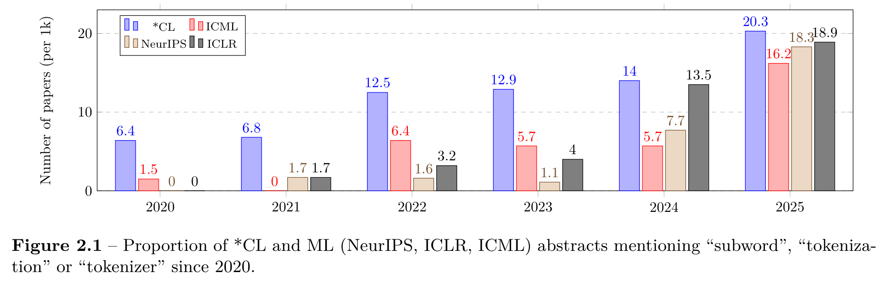
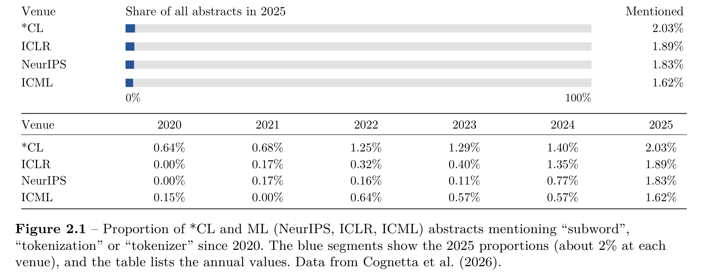

<h2>The original figure</h2>

The paper argues that tokenization receives little research attention compared with other parts of language models. It introduces Figure 2.1 with the following paragraph.

<blockquote>
Taken together, these factors have greatly limited experimentation with tokenization relative to other areas of the neural language modeling stack. This disparity is reflected in the number of tokenization-related papers published each year in premier venues, compared to the total number of NLP papers, as shown in Figure 2.1. In 2025, papers about tokenization (though not necessarily exclusively about tokenization) made up at most 2% of all papers.
</blockquote>

Cognetta et al. (2026), p. 10. <a href="https://www.alphaxiv.org/abs/2609.tokenization-survey-modern-nlp">Read the paper</a>

<figure></figure>

However, the grouped bars draw attention to the increase over time and the differences between venues. The small share of papers discussing tokenization is less visually apparent. We redesigned the figure to make the paper’s main point easier to see, showing these proportions on a full 0–100% scale.

<h2>The redesign</h2>
<figure></figure>
<h2>What changed and why</h2>
<ul><li>Each full bar represents all abstracts at that venue. The blue segment makes the small share mentioning tokenization-related terms immediately visible.</li>
<li>The bars show 2025, when the share was highest at every venue. Even then, it was only about 2%.</li>
<li>Percentages make the proportions easy to interpret. The table gives the values for every venue and year.</li></ul>

The original figure makes changes over time easier to compare. The redesign puts the small share of mentions in focus, matching the point made in the accompanying paragraph.

