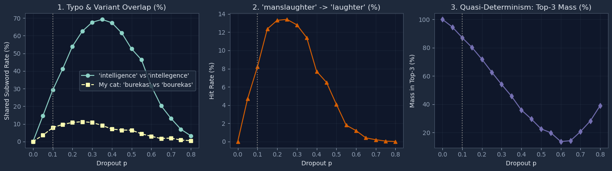

## What I reimplemented

I reimplemented **BPE-Dropout** (Provilkov et al., 2020; **Code 3.7** in Section 3.7) and evaluated three empirical properties of stochastic tokenization from **Section 8.1.1 (Subword Regularization)** across dropout rates `p` in `[0.0, 0.8]`:
1. **Typo & Transliteration Robustness (Example 8.1):** Measuring how often stochastic segmentations of `"intelligence"` (vs. typo `"intellegence"`) and my cat's name, **`"burekas"`** (vs. transliteration variant **`"bourekas"`**), expose shared subword tokens.
2. **Subword Semantic Drift:** Tracking how dropping `('s', 'l')` in `"manslaughter"` allows `'man'` to merge with `'s'` (`'mans'`), leaving `'l'` + `'aughter'` to form `('mans', 'laughter')`.
3. **Quasi-Determinism (Cognetta et al., 2024c):** Measuring the probability mass concentrated in the Top-3 most frequent segmentations as `p`.

## The code

```python
import random
from collections import Counter
import numpy as np
import matplotlib.pyplot as plt

# 1. Verified BPE Merge Table (lower index = higher priority)
MERGE_LIST = [
    # --- Example 8.1: "intelligence" vs "intellegence" ---
    ('i', 'n'), ('t', 'e'), ('e', 'n'), ('c', 'e'), ('en', 'ce'),
    ('l', 'l'), ('in', 'te'), ('inte', 'll'), ('i', 'g'),
    ('intell', 'ig'), ('intellig', 'ence'), # Clean (p=0): ('intelligence',)
    # Typo path for "intellegence" -> ('intell', 'eg', 'ence') (no single-char tokens!)
    ('e', 'g'), ('intell', 'eg'),

    # --- Fun Case 1: "manslaughter" -> ('manslaughter',) vs ('mans', 'laughter') ---
    # Build 'man' and 'aughter' first; then ('s','l') competes directly with ('man','s')!
    ('m', 'a'), ('ma', 'n'),
    ('a', 'u'), ('g', 'h'), ('te', 'r'), ('au', 'gh'), ('augh', 'ter'),
    ('s', 'l'),           # Higher priority: 's'+'l' -> 'sl' -> 'slaughter' -> 'manslaughter'
    ('man', 's'),         # Competing merge if ('s','l') is dropped: 'man'+'s' -> 'mans'!
    ('sl', 'aughter'), ('man', 'slaughter'),
    ('l', 'aughter'),     # Now 'l' + 'aughter' merges into 'laughter'!

    # --- Fun Case 2: My cat "burekas" vs "bourekas" ---
    ('b', 'u'), ('r', 'e'), ('k', 'a'), ('ka', 's'),
    ('bu', 're'), ('bure', 'kas'),          # Clean (p=0): ('burekas',)
    ('o', 'u'), ('b', 'ou'), ('re', 'kas')  # Variant (p=0): ('bou', 'rekas')
]
assert len(MERGE_LIST) == len(set(MERGE_LIST)), "Duplicate merge pair!"
RANKS = {pair: i for i, pair in enumerate(MERGE_LIST)}

# 2. Algorithm 3.3 + Code 3.7 (BPE-Dropout)
def bpe_tokenize(word: str, ranks: dict, p: float = 0.0) -> tuple[str, ...]:
    pretoken = list(word)
    while len(pretoken) > 1:
        possible_merges = [
            pair for pair in zip(pretoken, pretoken[1:])
            if pair in ranks and random.random() > p
        ]
        if not possible_merges:
            break
        best_pair = min(possible_merges, key=lambda pair: ranks[pair])
        
        new_pretoken, i = [], 0
        while i < len(pretoken):
            if i < len(pretoken) - 1 and (pretoken[i], pretoken[i + 1]) == best_pair:
                new_pretoken.append(pretoken[i] + pretoken[i + 1])
                i += 2
            else:
                new_pretoken.append(pretoken[i])
                i += 1
        pretoken = new_pretoken
    return tuple(pretoken)

# 3. Console Sanity Check
random.seed(42)
print("Clean (p=0):", bpe_tokenize("intelligence", RANKS, 0.0))
print("Typo  (p=0):", bpe_tokenize("intellegence", RANKS, 0.0))
print("Cat   (p=0):", bpe_tokenize("burekas", RANKS, 0.0), "vs", bpe_tokenize("bourekas", RANKS, 0.0))
print("Crime (p=0):", bpe_tokenize("manslaughter", RANKS, 0.0))
print("Crime samples (p=0.2):", Counter([bpe_tokenize("manslaughter", RANKS, 0.2) for _ in range(200)]).most_common(3))

# 4. Run Monte Carlo Evaluation (N = 2000 per p)
p_vals = np.linspace(0.0, 0.8, 17)
N = 2000

typo_intel = set(bpe_tokenize("intellegence", RANKS, p=0.0))   # {'intell', 'eg', 'ence'}
typo_burekas = set(bpe_tokenize("bourekas", RANKS, p=0.0))     # {'bou', 'rekas'}

intel_overlap, burekas_overlap, top3_mass, laughter_rate = [], [], [], []

for p in p_vals:
    s_intel = [bpe_tokenize("intelligence", RANKS, p) for _ in range(N)]
    s_bur   = [bpe_tokenize("burekas", RANKS, p) for _ in range(N)]
    s_ms    = [bpe_tokenize("manslaughter", RANKS, p) for _ in range(N)]
    
    intel_overlap.append(sum(1 for s in s_intel if set(s) & typo_intel) / N * 100)
    burekas_overlap.append(sum(1 for s in s_bur if set(s) & typo_burekas) / N * 100)
    top3_mass.append(sum(c for _, c in Counter(s_intel).most_common(3)) / N * 100)
    laughter_rate.append(sum(1 for s in s_ms if "laughter" in s) / N * 100)

# 5. Plot Results
fig, axes = plt.subplots(1, 3, figsize=(14, 4))
axes[0].plot(p_vals, intel_overlap, 'o-', label="'intelligence' vs 'intellegence'")
axes[0].plot(p_vals, burekas_overlap, 's--', label="My cat: 'burekas' vs 'bourekas'")
axes[0].set(title="1. Typo & Variant Overlap (%)", xlabel="Dropout p", ylabel="Shared Subword Rate (%)")
axes[0].legend()

axes[1].plot(p_vals, laughter_rate, '^-', color='#d95f02')
axes[1].set(title="2. 'manslaughter' -> 'laughter' (%)", xlabel="Dropout p", ylabel="Hit Rate (%)")

axes[2].plot(p_vals, top3_mass, 'd-', color='#7570b3')
axes[2].set(title="3. Quasi-Determinism: Top-3 Mass (%)", xlabel="Dropout p", ylabel="Mass in Top-3 (%)")

for ax in axes:
    ax.axvline(0.1, color='gray', linestyle=':', label='p=0.1')
    ax.grid(alpha=0.3)
plt.tight_layout()
plt.show()
```

## Results



All three metrics align with the theoretical claims in Section 8.1.1:

* **Subword overlap on Example 8.1 & `"burekas"` (Panel 1):** At `p = 0.0` (deterministic BPE), `"intelligence"` (`('intelligence',)`) and `"intellegence"` (`('intelleg', 'ence')`) share **0%** of their tokens, as do `"burekas"` (`('burekas',)`) and `"bourekas"` (`('bou', 'rekas')`). At `p = 0.1`, shared subword overlap jumps to **~30%** for `"intelligence"` (exposing `'ence'`) and **~8%** for `"burekas"` (exposing `'rekas'`), peaking around `p = 0.25–0.35` (**~70%** and **~11%**) before dropping near **0%** at `p = 0.8` as words fracture into individual characters.
* **The `"manslaughter"` → `"laughter"` effect (Panel 2):** At `p = 0.0`, `"manslaughter"` deterministically merges into `('manslaughter',)` (**0%** `"laughter"`). Under BPE-dropout, `('mans', 'laughter')` becomes the second most frequent segmentation, hitting **~8%** at `p = 0.1` and peaking at **~13.5%** at `p = 0.20–0.25` before decaying to 0% at high `p` when `'aughter'` itself fails to merge.
* **Quasi-determinism & high-`p` character collapse (Panel 3):** At `p = 0.1`, **~87%** of all segmentations of `"intelligence"` fall into the **Top-3 splits**, confirming Cognetta et al. (2024c)'s claim that BPE-dropout samples quasi-deterministically rather than uniformly. Diversity peaks at `p = 0.6` (Top-3 mass drops to **~14%**), after which Top-3 concentration rises back to **~39%** at `p = 0.8` because extreme dropout forces runs into the same unmerged character sequence.
* **Why token IDs differ from Example 8.1:** Example 8.1 lists GPT-4 (`cl100k_base`) token IDs. Because production Rust tokenizers (`tiktoken`) hardcode deterministic merges and do not expose the inner loop for per-step dropout, I used a local priority table over the target words.

## What I learned

* **BPE-dropout's narrow sweet spot (`p ≈ 0.1–0.2`):** Low `p` remains heavily concentrated on the canonical path, moderate `p` exposes shared stems for typos and transliterations (`"intellegence"`, `"bourekas"`) at the occasional cost of semantic drift (`"laughter"`), and high `p` collapses words into single-character noise—motivating length-biased samplers like **GRaMPa** (Bauwens et al., 2025).
* **Merge competition mechanics:** Because Code 3.7 re-evaluates all valid adjacent pairs at every `while` iteration, dropping a high-priority merge (`('s', 'l')`) for a single step only alters the final tokenization if an adjacent lower-priority merge (`('man', 's')`) immediately consumes one of its boundary tokens.
