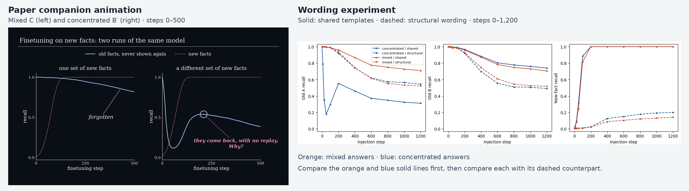
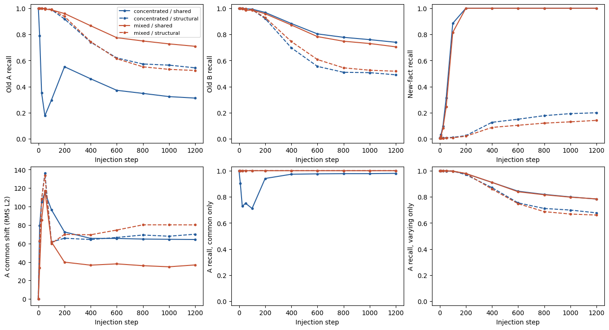
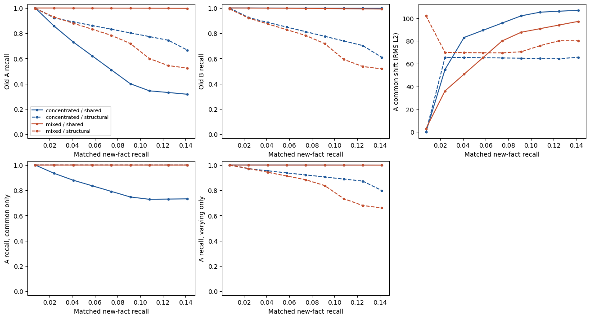

## What I reimplemented

**Figure 1** of *When Forgetting is not Catastrophic: On the Mechanics of Spurious Forgetting*. The figure has two fine-tuning runs from the same pretrained model:

- **C (mixed answers).** The new facts take their answers from the answer pools of both old groups. Old-fact recall drops slowly.
- **B′ (concentrated answers).** The new facts take their answers only from old group B's pool. Old group A's recall collapses early, then **comes back partly without any replay**. This is the "spurious" part of the title.

The paper explains the collapse with a **shared logit shift**: fine-tuning pushes all old prompts toward the new answers in the same direction, and the shift can later be undone. That explanation is about *answers*. It does not say whether the *wording* of the new text matters. So I added one extra condition:

> **Question.** If the new biographies use different wording from the pretraining biographies, does the collapse change?

That gives four arms, 2 answer pools × 2 wordings. The two shared-template arms recreate Figure 1. The two structural arms are mine and are **not** in the paper.

## The setup

**Starting point.** The repository's MLP-free Transformer at pretraining step 16,000. Before fine-tuning it recalls **100%** of first answer tokens for both old groups (A and B). The notebook checks for at least 90% before it continues.

**Data.** Every person has six facts: birth year, birthplace, university, major, employer and work location. For each attribute, old A takes its answers from half X of the value pool and old B from half Y. The new people are the same in all four arms:

- *Concentrated* answers come only from Y (B′ in the paper, `disjoint` in the code).
- *Mixed* answers come from X ∪ Y (C in the paper, `all_values` in the code). In the saved run, the share from old A's half was 46.6% to 54.8% across attributes.

**The two wordings.** Take one new person, Ada Morgan Lee, with birth year 1912 and birthplace Paris:

| Wording | What the model reads during fine-tuning |
| --- | --- |
| Shared templates (the paper's) | The birth year of Ada Morgan Lee is recorded as 1912. The birthplace of Ada Morgan Lee is the city of Paris. |
| Structural (dossier-style, new) | The birth year of Ada Morgan Lee. 1912. The birthplace of Ada Morgan Lee. Paris. |

Both wordings use the same token IDs for the name and the answer, so they run on the same checkpoint and vocabulary. Within each answer pool, the two wordings have the same people, facts, attribute order, sampler seed and number of times each person is seen. I checked these with asserts. Old and new people share **zero** exact person–attribute–value triples.

**Evaluation.** All four arms are tested on the **original-style held-out templates**, scoring whether the model predicts the first token of the answer (argmax over the full vocabulary). Old A and old B are tested on their own fixed biographies, which never appear in fine-tuning.

**Training.** Each arm starts from the same parameters with a fresh AdamW state, the same constant learning rate, and runs 1,200 injection steps.

```python
# Notebook §4, run_arm(): inner loop, simplified
for step in range(1, N_STEPS + 1):
    batch = view.get_batch()                       # new biographies only
    state, loss = train_step(state, batch)         # repository loss
    if step in EVAL_STEPS:
        logits_A = fixed_readout(state, old_A)     # first-answer positions
        shift = (logits_A - logits_A0).mean(axis=people)   # shared per-attribute shift
        log(recall(old_A), recall(old_B), recall(new),
            rms_l2(shift),
            recall(logits_A0 + shift),             # "common only"
            recall(logits_A - shift))              # "varying only"
```

Full code and saved outputs: [biography_wording_forgetting.ipynb](https://github.com/active-ai-reading/active-ai-reading.github.io/blob/main/assets/notebooks/spurious-forgetting-biography-wording/biography_wording_forgetting.ipynb). It uses the paper's repository (JAX) for the data, model, checkpoint and training step.

**A caveat about the intervention.** The dossier entries are on average about **6.6 tokens shorter** per biography, and their answers sit about **3.4 tokens earlier**. They also have less template variety. So "wording" here means phrasing, template diversity and answer position all changing together.

## Results

### 1. The shared-template arms reproduce Figure 1



*Left: final frame of the paper's companion animation (500 steps). Right: my run (1,200 steps). Blue is concentrated answers, orange is mixed. Solid is shared templates, dashed is structural wording.*

Compare the **solid** lines with the paper first:

- **Concentrated / shared (solid blue)** behaves like B′. Old A falls from 100% to **17.7%** by step 50, comes back to about **55%** around step 200 with no replay, then declines to 31.2%.
- **Mixed / shared (solid orange)** behaves like C. Old A declines slowly to **70.9%**, with no early dip.
- Both reach **100%** new-fact recall by step 200.

So the qualitative pattern of Figure 1 reproduces. This is one seed, while the paper's plotting code averages 3 mixed and 5 concentrated runs, so I compare the shape, not the exact values.

### 2. Wording changes forgetting, in opposite directions



*Top row: recall of old A, old B and new facts. Bottom row: size of the shared logit shift on old A, and old A recall when only the shared shift is applied (common only) or removed (varying only).*

| Arm | Old A lowest | Old A final | Old B final | New facts final | Peak shared shift |
| --- | ---: | ---: | ---: | ---: | ---: |
| Concentrated / shared | **17.7%** | 31.2% | 74.0% | 100.0% | 115.5 |
| Concentrated / structural | 54.4% | 54.4% | 49.1% | **20.0%** | 136.2 |
| Mixed / shared | 70.9% | 70.9% | 70.5% | 100.0% | 117.3 |
| Mixed / structural | 52.4% | 52.4% | 51.8% | **14.2%** | 133.7 |

*Final values are at step 1,200. The shift is the root mean square across attributes of the L2 norm of the mean change in old A's logits.*

- **Concentrated answers: dossier wording removes the collapse.** The dashed blue line has no early dip; it declines smoothly. Old A ends **23.2 points higher** than with shared templates. But old B ends **24.9 points lower**. The forgetting moves from A to B instead of disappearing.
- **Mixed answers: dossier wording makes forgetting worse.** Old A ends **18.5 points lower** and old B **18.7 points lower** than with shared templates.
- **New facts: the dossier arms barely transfer.** They reach only 20.0% and 14.2% on the original-style prompts. I did **not** test them on held-out dossier-style prompts, so I cannot tell if they learned less, or learned the facts in a format that does not carry over to the test prompts.

Interestingly, the two dashed lines almost overlap on old A and old B. With dossier wording, *where the answers come from* matters much less. The difference between B′ and C that the paper emphasizes is mostly a property of the shared-template arms.

### 3. At matched new-fact recall, the sign flips

Comparing arms at the same step is not fair when one arm learns the new facts five times better. So I also compared them at the **same new-fact recall**: for each target, I took each arm's first crossing and interpolated between saved evaluations.



All four arms only overlap between about **0.7% and 14.2%** new-fact recall, the ceiling of the weakest arm. At 14.2%:

| Answer pool | Old A, shared | Old A, structural | Structural − shared |
| --- | ---: | ---: | ---: |
| Concentrated | about 32% | about 67% | **+34.9 points** |
| Mixed | about 100% | about 52% | **−47.3 points** |

The effect of wording has opposite signs in the two pools even here. Mixed / shared barely forgets anything at this level, while mixed / structural has already lost half of old A. The range is narrow and early in training, and the matched points come from different steps and different numbers of examples seen.

### 4. Is the shared logit shift the cause? Only in one arm

The paper's explanation predicts that a bigger shared shift means more forgetting. Two measurements disagree with that simple version:

- **Representation overlap goes down with dossier wording.** Before fine-tuning, the cosine between old A and new vectors at the answer position is about **0.070–0.127** with shared templates and **0.002–0.038** with dossier entries (all 12 pool × attribute pairs drop).
- **But the shared shift goes *up*.** The peak shift is 134–136 for the dossier arms against 116–117 for the shared arms (bottom-left panel above). Yet the concentrated / structural arm, with the largest shift, has no collapse.

The size of the shift does not track the damage; its *direction* relative to the correct answers does. The two counterfactual readouts show this:

- **Common only** (old logits + shared shift): only **concentrated / shared** dips, to about 71% around step 100. The other three stay near 100%, even though their real recall falls. So in those three arms, forgetting is not caused by the shared shift.
- **Varying only** (current logits − shared shift): removing the shift saves much of the early recall in concentrated / shared. In the other arms it changes little.

So the shared-shift explanation fits the arm that the paper studies (concentrated, shared wording). In the other three arms, the forgetting comes from the person-specific part of the change. These readouts are not an additive split of the lost accuracy, because first-token accuracy depends on the argmax of the combined logits.

## What I learned

- **Figure 1 reproduces.** With shared templates, concentrated answers give the collapse and partial recovery, and mixed answers give slow forgetting, on a single seed of the repository's model.
- **Spurious forgetting depends on the wording, not only the answers.** Dossier-style text removed the concentrated-answer collapse, but moved the damage to old B, and made forgetting worse under mixed answers. Wording and answer pool interact.
- **Less overlap in representation does not mean less forgetting.** The dossier wording lowered the old–new cosine everywhere and still increased forgetting in the mixed pool.
- **The shared logit shift explains the collapse, but not all forgetting.** Its size is a poor predictor; only in concentrated / shared does applying it alone reproduce a drop.
- **Caveats.** One injection seed and one pretrained checkpoint. The wording intervention also changes length, answer position and template variety. The dossier arms were never scored on dossier-style held-out prompts, so their low new-fact recall may be a transfer problem rather than a learning problem. The external-encoder comparison in the notebook was not run.
- **Next steps.** Score new facts on both prompt styles in every arm; add paired seeds and a second checkpoint; and build a lighter paraphrase that keeps the answer position and template variety fixed, to find which feature of the wording matters.
