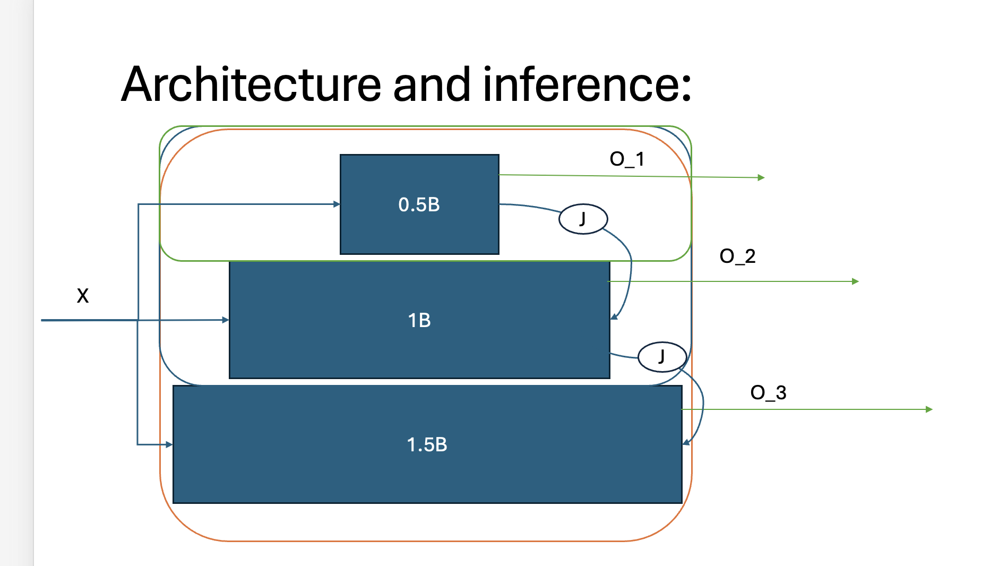

### Handoff - Visualizing the Key Idea - week 1

For writing the post, i read the papers in 2 passes:

1. just reading the content to get the basic ideas.
2. reviewing the existing graphs + explanations, looking for what could benefit from visual explanations.

afterwards i created my a prototype of the slides i wanted to make - by hand first, then in Microsoft Powerpoint:

The rest was mostly back-and-forth with ChatGPT to get something both aesthetically pleasing and with explanative value.

the interactive graph was in html, and the image was in svg. I asked Chat to create 2 scripts, so it would remain consistent throughout the changes.
Integrating the html in the markdown file afterwards was pretty annoying, but now that i did that i think it could be easily copy-pasted.

That's it.

Good Luck!
